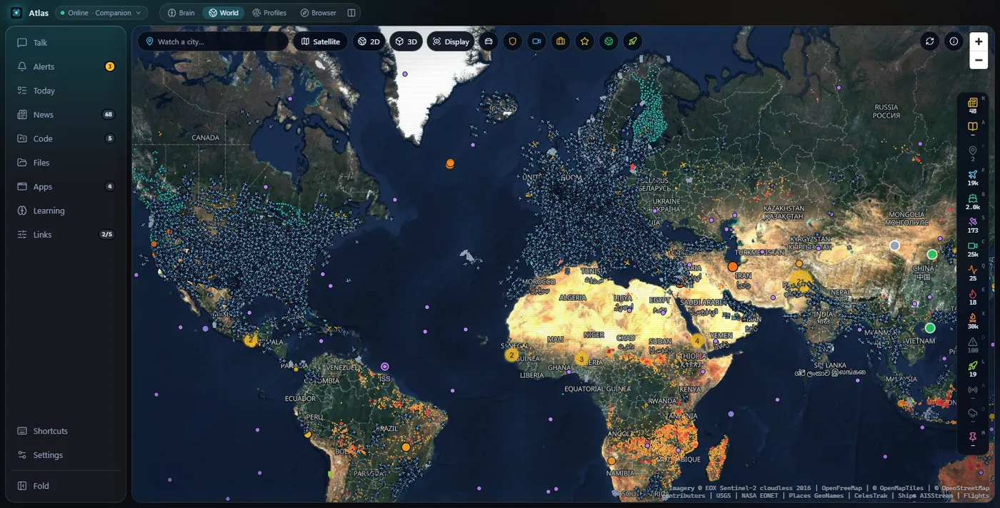
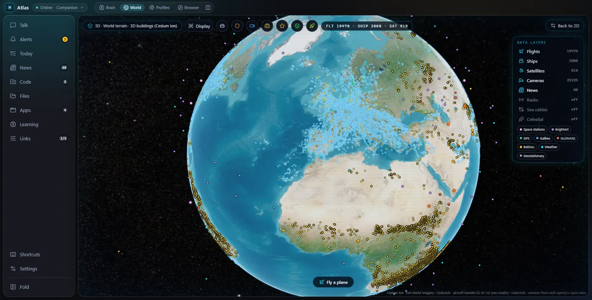
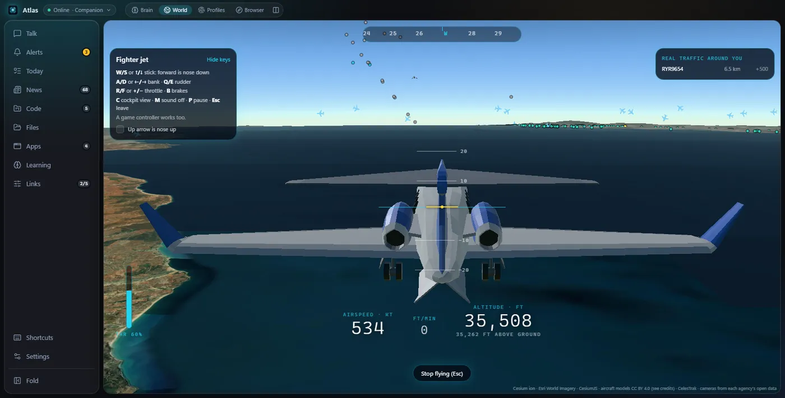
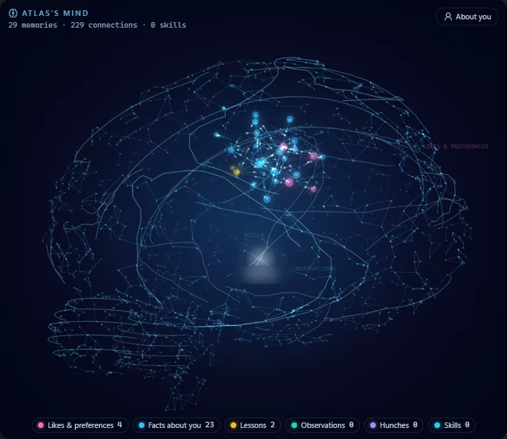

<div align="center">

# Atlas

**A personal assistant that lives on your PC, remembers your work, and speaks up when it matters.**

Talk to it in English or Roman Urdu. It keeps your tasks and promises, watches the world for you,<br>
drives a browser and your apps when you allow it, and opens in any browser on your home network.

[](https://github.com/abdullahliaqatali31/atlas-assistant/actions/workflows/ci.yml)
[](LICENSE)




</div>

## Why Atlas

Most assistants wait for a command and forget you the moment you close them. Atlas is meant to be a working companion:

- **It remembers.** Tasks, promises, people, preferences and lessons live in a local database and in a `MEMORY.md` file you can open and edit. Correct a line and Atlas knows.
- **It speaks up, sparingly.** A morning briefing, a reminder before something is due, a word when you come back. You set quiet hours and limits, and Atlas learns which nudges you usually pass on and keeps those quiet.
- **It acts, with your yes.** It can browse, read your files, use desktop apps, send email and add calendar events. Anything that sends, pays, deletes or changes something asks you first, every time, unless you made a rule.
- **It is yours.** One small Node.js process on your PC (about 260 MB of memory). Your keys stay in Windows Credential Manager. Nothing is sent to this project, and there is no account.

## A look around

<table>
<tr>
<td width="50%"></td>
<td width="50%"></td>
</tr>
<tr>
<td><b>The world in 3D.</b> Live flights, ships, satellites, public cameras, quakes, fires and news on a globe with real terrain.</td>
<td><b>Fly it yourself.</b> Take a Cessna, an airliner or a fighter jet among the real planes in the sky right now. Fly into one and it ends in a fireball.</td>
</tr>
<tr>
<td></td>
<td>

**What Atlas knows, drawn as a mind.** Each memory is a point; related memories connect. When Atlas uses a memory in a conversation, it lights up.

Everything here is also plain Markdown you can edit, and an optional local model finds memories by meaning, in Urdu or English ("meri behan ki shadi kab hai" finds "your sister's wedding is in December").

</td>
</tr>
</table>

## Install

On Windows 10 or 11, in PowerShell:

```powershell
iwr -useb https://github.com/abdullahliaqatali31/atlas-assistant/releases/latest/download/install.ps1 | iex
```

That brings Node.js if it is missing, installs Atlas into `%LOCALAPPDATA%\Atlas`, puts the `atlas` command on your PATH, and opens Atlas in your browser. Or download a release zip and run `install.ps1 -From .\atlas-<version>-win-x64.zip`.

```text
atlas            start Atlas and open it in your browser
atlas stop       stop it
atlas status     is it running, and where
atlas logs       the last lines of its log
atlas update     install the latest release (--check only tells you)
```

**What you need:** an AI provider and a voice provider, with your own keys. Setup walks you through it and lists the models your key can use.

| | Choices |
| --- | --- |
| AI | Claude, OpenAI, Google Gemini, OpenRouter, Groq, DeepSeek, Mistral, xAI, any OpenAI-compatible server, or a free local model through Ollama |
| Voice | ElevenLabs, Azure AI Speech (includes natural Urdu voices) or OpenAI |

No GPU is needed: the heavy work runs on your providers, and the local models (wake word, Voice ID, recall by meaning) are small, optional and download only when you turn them on.

## What it can do

<details>
<summary><b>Conversation and voice</b></summary>

- Type or talk; Atlas answers aloud, sentence by sentence, and stops the moment you talk over it.
- English, Roman Urdu, Urdu script or a mix; you choose how it talks, its name and how firmly it disagrees.
- Instant answers without the model: "kitne baje hain", "bas", "focus mode", "awaz tez karo", "news dikhao", "5 minute ka timer".
- Optional wake word, live voice conversation, and a level meter that tells you when the mic is too quiet.
- **Voice ID** knows your voice from others (voice prints stay on your PC, encrypted). Personal answers go only to you; guests are treated as guests. It is never used as a lock: voices can be cloned.

</details>

<details>
<summary><b>Memory and initiative</b></summary>

- Tasks with evidence, commitments ("I'll send the quote tomorrow"), facts, preferences, lessons and corrections, in SQLite on your PC.
- A Markdown mirror (`MEMORY.md` and a note per day) that you can read and edit; edits flow back.
- Recall by meaning with a small multilingual model, blended with keyword search.
- Speaking up: briefings, due reminders, welcome-backs, project nudges. Quiet hours, a daily limit and a minimum gap are yours to set; Atlas learns which ones are welcome when.
- "Why did you say this?" under every unprompted message, plus Not now and Don't remind me again.

</details>

<details>
<summary><b>Hands: browser, files, apps, mail and more</b></summary>

- **Its own browser:** your Chrome or Edge driven through Playwright, shown as a live picture you can click and type into.
- **Files:** only the folders you add; reading a file asks you first; organising can be undone.
- **Desktop apps** through Windows UI Automation, per app: open, read the screen, or control.
- **Gmail, Calendar and Outlook:** read, and send or create with a yes each time.
- **Telegram:** talk to Atlas from your phone, get its notices, approve actions with a button.
- **Timers and alarms**, a look at the screen when you ask, skills in the shared `SKILL.md` format, and any **MCP** connector, local or remote.
- **Your PC:** code projects, recent work, notifications from WhatsApp and Teams (urgent senders first), and what you were doing when you come back.

</details>

<details>
<summary><b>World, news and maps</b></summary>

- Watch the places you care about: weather, air quality, earthquakes, wildfires, storms and floods, with alerts when something happens there.
- Live flights (with routes), ships, satellites and the ISS, public traffic cameras, rocket launches, radio stations, sea cables.
- A flat map and a 3D globe with real terrain (and 3D cities with a Cesium ion or Google key), tactical display modes and a guided tour.
- News from public feeds with your choice of sources, placed on the map, saved for later.

</details>

<details>
<summary><b>Fly a plane</b></summary>

World › 3D › **Fly a plane**. Start over the middle of the screen, or **Join traffic** to start behind a real flight in the air right now.

| Key | |
| --- | --- |
| W / S or ↑ / ↓ | stick (forward is nose down; an option swaps it) |
| A / D or ← / → | bank, which is how you turn |
| Q / E | rudder |
| R / F or + / − | throttle |
| C | cockpit or chase view |
| B, M, P | brakes, sound, pause |
| Esc / Enter | stop flying / fly again after a crash |

A game controller works too. The flight model is arcade, not a simulator: it turns when banked, stalls when slow, and lands if you are gentle. Crashing into a real plane happens only in your game.

</details>

<details>
<summary><b>On every device at home</b></summary>

The interface is a web page served by Atlas on your PC. It listens only on this PC unless you allow other devices; each browser (a phone, a tablet, another laptop) is paired once with a code. A small tray icon gives notices and global shortcuts.

</details>

## Privacy and safety

- **A gate outside the model.** Every action passes a deterministic policy check. Sending, paying, deleting and anything new asks you; webpages, emails, messages and files are treated as information, never as instructions.
- **Stop all** from the tray, `Ctrl+Alt+P` or a button silences Atlas and cancels everything it is doing.
- **Local and inspectable.** Memory is on your PC, readable and deletable. No keystroke logging, no continuous screen recording. Backups are encrypted with your passphrase and never include keys.
- **Paired devices only** on the web interface, with origin checks and owner-only actions.

See [SECURITY.md](SECURITY.md) to report a problem.

## How it is built

```text
 browser tab(s) ──HTTP + WebSocket──▶ gateway (Node) ──IPC──▶ runtime (Node)
                                        │                       │
                                 tray (PowerShell)        LLM, voice, MCP,
                                 Chrome/Edge (Playwright)  SQLite memory
```

A pnpm monorepo in TypeScript: React for the page, MapLibre and CesiumJS for the maps, `node:sqlite` for memory, sherpa-onnx and transformers.js for the small local models. The gateway serves the page and every call through one compressed WebSocket; the runtime holds the assistant. Details in [docs/ARCHITECTURE.md](docs/ARCHITECTURE.md).

## From source

```bash
pnpm install
pnpm dev        # builds, runs and reloads on change; open http://localhost:47800
pnpm check      # typecheck and all tests
pnpm dist       # the release zip in apps/desktop/release
```

Developer tools: `pnpm chat` (a text console), `pnpm doctor --live` (checks your keys with one real reply and a voice round trip), `pnpm keys set <NAME>`.

Contributions are welcome. Read [CONTRIBUTING.md](CONTRIBUTING.md) first: safety rules are not negotiable in review, tests cover failure paths, and no personal data goes in code or tests. The plan and what is next are in [docs/ROADMAP_V1.md](docs/ROADMAP_V1.md) and [docs/PERFORMANCE.md](docs/PERFORMANCE.md).

## Status

Version 0.4, before the first public release. Everything above works today on Windows; the installer is not code-signed yet, so Windows SmartScreen asks once ("More info › Run anyway").

## Credits and license

Atlas is licensed under [Apache-2.0](LICENSE) (see also [NOTICE](NOTICE)). Third-party packages are listed in [docs/THIRD_PARTY_LICENSES.md](docs/THIRD_PARTY_LICENSES.md). The 3D aircraft models are CC BY 4.0 by their creators (credited in [apps/desktop/src/renderer/public/models/README.md](apps/desktop/src/renderer/public/models/README.md)). Map imagery and live data come from public sources, each credited on the map: among them EOX Sentinel-2 cloudless, OpenFreeMap and OpenStreetMap, USGS, NASA, Open-Meteo, CelesTrak, GeoNames and the agencies that publish their traffic cameras.
