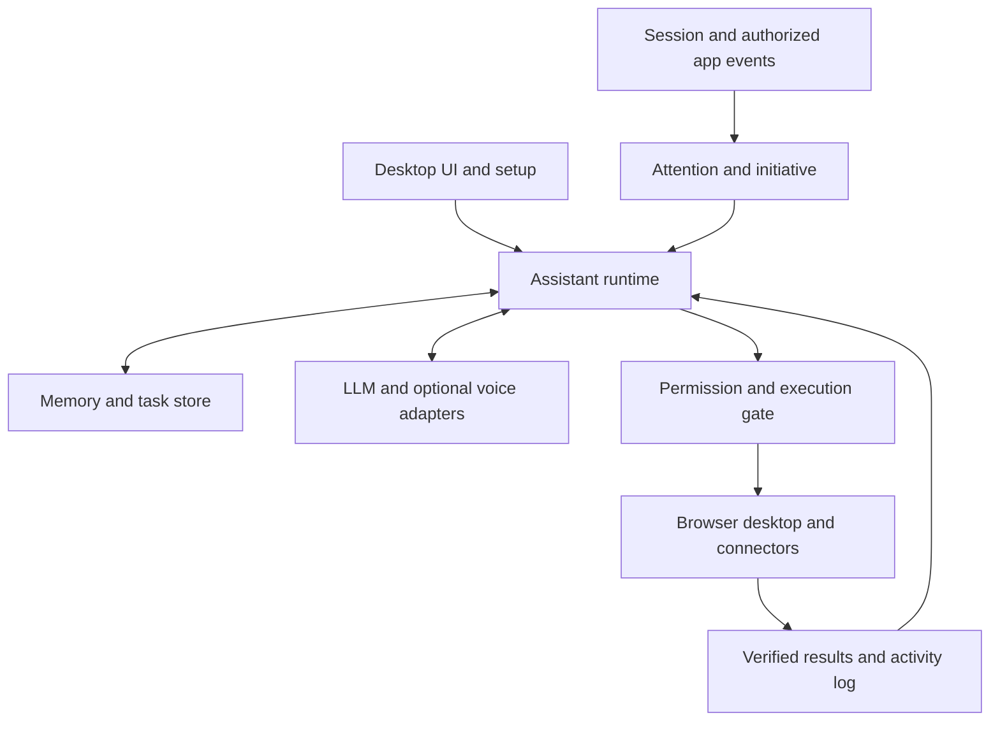

# Personal Desktop Assistant Project Plan

Version 1.1 | 17 October 2026 | Prepared for Abdullah Liaqat Ali

Implementation baseline for an open source personal assistant. Working project name: Personal Assistant. Final brand name remains open. This document finalizes the proposed architecture and release scope; it does not claim that implementation or hardware validation has been completed.

### Changes in 1.1

- **Hardware-neutral by default.** The product targets any Windows 11 machine, not the author's laptop. Heavy inference is cloud-first; local models are an optional, capability-detected tier (see 12.1).
- **Required providers at setup.** A fresh install requires an LLM API key and a voice provider API key. Voice is a core experience, on by default. Text chat remains available at all times as an input surface and as the fallback when a voice provider fails.
- **MCP as the connector layer.** The runtime is an MCP client for integrations and also exposes its own memory/tasks as an MCP server (new section 13.1).
- **Grounded briefings in alpha.** Official calendar/email connectors and opt-in active-window tracking move into the personal alpha so briefings have real evidence (13.2).
- **Messaging previews** via the Windows notification listener evaluated in Phase 0 (13.3).
- **Windows Hello** as the preferred app-unlock factor; prompt caching and model tiers in the LLM layer; renderer teardown in tray to meet RAM targets.

## 1 Product decision

Build a Windows first desktop assistant that maintains continuity across working days, learns owner preferences and successful workflows, initiates useful conversations, and performs authorized work through integrations, browser automation and desktop controls. Memory and orchestration live locally. A user supplied LLM API powers reasoning. A user supplied voice provider API powers speech by default, with local engines as an optional tier for capable hardware.

The defining experience is a persistent working relationship: the assistant remembers commitments, understands current projects, notices relevant changes, offers grounded opinions and chooses appropriate moments to speak. Conversational warmth and humour are part of the experience. The product must represent its generated judgments honestly rather than claim consciousness or human free will.

### Finalized baseline decisions

| Area | Decision |
| --- | --- |
| Initial platform | Windows 11 x64; platform interfaces prepared for later ports |
| Application | Electron with React and TypeScript; no framework migration before measured need |
| Local runtime | Separate TypeScript background process supervised by the desktop application |
| Voice runtime | Optional isolated worker; native or Python implementation behind an adapter |
| Storage | SQLite with migrations and FTS5; optional embeddings after retrieval evaluation |
| LLM | Required at setup: bring your own API key; configurable provider, endpoint and model |
| Voice | Required at setup: bring your own voice provider key (cloud STT + TTS); local engines optional; input and output configured independently |
| Hardware | No GPU assumed; capability detection recommends optional local models per machine |
| Connectors | MCP client for integrations; runtime also exposes an MCP server for its memory and tasks |
| Browser | Playwright plus an opt-in extension for explicitly connected browser context |
| Desktop | Windows UI Automation first; vision and input simulation as fallback |
| Credentials | Windows Credential Manager through a maintained adapter |
| Distribution | Open source repository and signed Windows installer when signing is available |
| Code license | Apache 2.0 baseline; dependency and model licenses tracked independently |
| Account requirement | No account with this project; the owner's own LLM and voice provider accounts are required |
| Telemetry | Off by default; diagnostics shared only through an explicit user action |

These are implementation choices for this plan. Provider quality, voice language coverage and resource targets require validation.

## 2 Users and success

Primary user: a person handling multiple projects, client communications and computer tasks who wants an assistant with memory and initiative. The first owner, not a hardcoded identity. A fresh installation must learn any owner's name, language, work preferences and authorized sources through setup.

The assistant succeeds when it remembers verified commitments, retrieves the right context, makes useful interventions and completes bounded tasks without inventing progress. A pleasant voice alone is insufficient.

### Reference daily experience

1. At login or unlock, the runtime detects a new active session.
2. It checks authentication and attention state before revealing private information.
3. It greets the owner once, with an optional brief identity question where appropriate.
4. It offers a concise briefing based on verified tasks and updates, with sources available in the UI.
5. The owner can interrupt, joke, correct a fact or ask it to stay quiet.
6. It saves appropriate corrections, queues useful work and executes within configured permissions.
7. It verifies results and records unresolved items for the next session.

Example: “Hamza, do important items hain. Revised quote pending hai, aur client ki update request ayi hai. Pehle kis ko clear karein?” If access is incomplete, it says so rather than presenting a notification preview as the complete conversation.

## 3 Release boundaries

### Personal alpha

Include setup, voice and text conversation, LLM and voice provider configuration, persistent memory, projects, tasks, daily briefings, proactive check-ins, quiet mode, activity log, MCP client with calendar/email connectors, opt-in active-window tracking, one bounded browser workflow and file access within selected folders.

Exclude personal WhatsApp automation, arbitrary shell execution, unrestricted computer control, cross-device sync and continuous screen recording. These exclusions define sequencing rather than the long-term product ambition.

### Public beta

Add robust browser workflows, bounded desktop automation, connector framework, permission editor, encrypted backups, recovery, provider compatibility tests and a reproducible installer. Add one messaging connector only after access, completeness and reliability are validated. Personal WhatsApp support is not a release promise.

### Later releases

Other operating systems, mobile companion, optional always-on server, local LLMs, advanced workflow learning and carefully scoped screen context. No autonomous modification of application source or permission expansion.

## 4 Behaviour contract

The assistant may initiate greetings, relevant questions, reminders, summaries and suggestions. It may form and explain recommendations that disagree with the owner. It must distinguish observations, user statements, hypotheses and verified outcomes.

It must never infer identity solely from working habits, claim certainty about emotions from activity, mark work complete without evidence, or pretend to observe applications it cannot access. It must obey stop, mute, quiet hours and capture exclusions. Humour must adapt to preference and context.

### Conversation modes

| Mode | Behaviour |
| --- | --- |
| Companion | Natural conversation and bounded proactive engagement |
| Work | Concise updates and actionable suggestions |
| Focus | Queue routine updates; surface only configured urgent items |
| Quiet | No unsolicited speech; reminders follow explicit quiet-mode rules |
| Away | Pause foreground automation and defer private speech |
| Locked | Stop capture and private playback; suspend sensitive tools |

“Tum bohat bak bak karte ho” may trigger a light response and shorter replies in the current session. Save a permanent verbosity preference only from a clear instruction or a repeated pattern confirmed with the owner.

## 5 System architecture

Use a modular monolith with isolated workers. Avoid distributed infrastructure for a single-device application.



### Module responsibilities

| Module | Owns |
| --- | --- |
| Session service | Startup, unlock, lock, resume, idle and authentication state |
| Event bus | Typed events, correlation IDs, deduplication and bounded queues |
| Context builder | Relevant memory, project state, tool availability and redaction |
| Conversation manager | Session state, streamed replies and interruption cancellation |
| Initiative manager | Whether to intervene, channel, priority and cooldown |
| Planner | Bounded steps, dependencies and requested tool actions |
| Policy engine | Deterministic permission checks before every action |
| Executor | Tool invocation, timeout, cancellation and verification |
| Memory service | Evidence, retrieval, corrections and retention |
| Learning service | Candidate lessons and reusable workflow proposals |
| Provider manager | Keys, capabilities, configuration and health |
| Diagnostics | Local metrics, redacted logs and export |

Keep the Electron renderer sandboxed with context isolation enabled and Node integration disabled. Expose narrow validated IPC methods through a preload bridge. The renderer must not directly execute tools or read credentials. Authenticate local worker connections with a per-installation/session secret; bind to loopback or use restricted named pipes rather than an unauthenticated local HTTP control endpoint.

## 6 Runtime lifecycle

Application startup launches the supervised runtime after user login. Closing the main window minimizes to tray; Quit fully stops all processes and capture. Run at login is an explicit setup option, enabled only after selection.

On sleep, persist pending state and suspend tools. On resume, reconnect providers, reconcile timers and avoid duplicate briefings. On lock, stop private speech and capture. On crash, restore pending tasks as interrupted, verify external state before retry and never blindly repeat a send or destructive action.

One foreground desktop action owns the input lock at a time. Human mouse/keyboard activity pauses automation. Background browser jobs use a separate session where possible. The assistant may keep conversing while a worker performs a task, but new instructions can cancel or replace the task.

## 7 Memory model

SQLite is the authoritative record. Conversation logs, structured tasks and derived memory are separate. Embeddings are a rebuildable retrieval index, never the only source of truth.

| Entity | Key fields |
| --- | --- |
| Owner | ID, display name, timezone, languages, preferences |
| Project | ID, name, goals, current state, linked sources |
| Conversation | ID, session, timestamps, retention policy |
| Message | Speaker, content, source, redaction state |
| Memory | Type, statement, source references, confidence, validity, sensitivity |
| Task | Title, project, due time, status, dependencies, completion evidence |
| Commitment | Who promised what to whom, deadline, source, resolution |
| Observation | Authorized source, event time, extracted facts, expiry |
| Hypothesis | Proposed pattern, supporting evidence, confidence, confirmation state |
| Workflow | Versioned steps, required tools, permission scope, success history |
| Preference change | Old value, new value, reason, effective time, reversible flag |
| Action | Tool, arguments summary, permission decision, result, evidence |
| Source record | Origin, retrieval time, checksum/version, access scope |

Use UUIDs, UTC event timestamps and owner-local scheduling. Preserve source chronology and distinguish observation time from ingestion time. Store tasks through a state machine: proposed, ready, running, waiting, completed, failed, cancelled. Reopening a task retains its history.

### Retrieval and consolidation

Retrieve by project, entity, recency, importance and permission scope. Use FTS5 and structured filters first. Add embeddings only if measured recall failures justify them. Send a small evidence-backed context packet to the LLM rather than the entire database.

Consolidate when idle, with a cost budget. Deduplicate, link contradictions, expire stale observations and retain original evidence while policy allows. Corrections supersede earlier facts; generated summaries must not become independent evidence. Memory deletion also removes derived indexes, summaries and cached context that contain the deleted material. Backup retention is explained separately.

## 8 Learning and problem understanding

Initial learning changes stored knowledge, preferences and workflow definitions rather than model weights. Do not require fine-tuning for the first release.

The cycle is observe, extract candidate, evaluate evidence, confirm when needed, save, apply and assess outcome. Explicit low-risk preferences may be saved immediately with visible undo. Inferred personal traits, sensitive conclusions and workflow changes with external effects require confirmation.

Examples: remembering preferred estimate formatting; noticing recurring overdue follow-ups; suggesting a daily reply queue; learning that a successful quote workflow includes drawings review before pricing. The assistant must distinguish preference from one-off instruction and correlation from cause.

Workflow learning produces declarative steps using existing tools. It cannot create executable code and run it with inherited permissions. New tools or executable plugins go through explicit installation and permission review. A learning history screen shows what changed and why.

## 9 Initiative and attention

Events include first daily session, return from idle, due commitment, authorized message arrival, task failure and meaningful project change. Local filters process events before an LLM is called.

Evaluate relevance, urgency, confidence, novelty, interruption cost and owner preference. Choose speech, notification, dashboard queue or suppression. Store the decision so duplicate events do not produce repeated alerts.

Starting defaults: no more than one routine unsolicited check-in per 60 minutes, no repeated daily briefing, a daily routine-intervention budget of five, and quiet hours configured by the owner. Explicit timers and urgent rules are tracked separately. These are tunable product defaults, not learned facts about the user.

“Not now” snoozes the item. “Stop” cancels current speech and pauses the relevant activity. “Do not remind me again” disables that reminder without deleting the underlying task. The UI exposes why an intervention happened.

## 10 Personality and opinions

Stable identity defines honesty, practical judgment and respectful humour. Owner preferences define tone, language, nickname, verbosity and disagreement style. Session state controls temporary focus or mood of the conversation.

Opinions must connect to owner goals and evidence: “I recommend clearing the quote before starting the new feature because the client deadline is today.” The assistant can revise its opinion after correction. It must not invent personal experiences or claim distress to influence the owner.

Personality changes are versioned. Provide reset, export and undo. The assistant cannot rewrite its security policy, hide actions or alter the owner's configured limits as part of personality adaptation.

## 11 LLM providers

Implement a provider interface for streaming text, tool calls, optional image input, cancellation, usage and errors. Initial supported paths: one tested OpenAI-compatible chat adapter and one native provider adapter selected during implementation. Compatibility means passing tests, not merely accepting a custom URL.

Configuration includes provider, endpoint, model, key reference, context limits, tool support, vision support, timeout and budget. Validate HTTPS for remote endpoints; explicitly label local HTTP endpoints. Never forward a key to another provider during fallback.

Use local rules for presence and scheduling. Use a fast configured model for conversation and classification, with optional stronger-model escalation (for example with Claude: Haiku for chat and classification, Sonnet or Opus for planning, and the computer-use tool for the vision fallback). Use provider prompt caching for the stable persona, policy summary and memory packet so frequent check-ins stay cheap. Apply token budgets, maximum tool steps, per-task spend and daily limits. Cache only where privacy and freshness permit.

Network failure leaves local tasks and memory available. The UI shows which capabilities are offline. Do not claim autonomous reasoning continues when its required provider is unavailable.

## 12 Configurable voice

Voice is a core experience and is configured during setup with the owner's own voice provider key. The default path is cloud speech-to-text and text-to-speech so quality does not depend on the owner's hardware. Text chat is always available beside voice and is the automatic fallback when the voice provider is unreachable, over budget or muted; memory, initiative, tools and personality never depend on voice. Configure speech recognition and speech synthesis independently.

| Setting | Options |
| --- | --- |
| Voice mode | Push to talk (default), wake phrase, explicit conversation session, muted |
| Input provider | Local STT or cloud streaming STT |
| Output provider | Local TTS or cloud streaming TTS |
| Output settings | Voice ID, model, language, rate, volume, pronunciation overrides |
| Audio hardware | Microphone, speakers, test and level meter |
| Privacy | Local/cloud indicator, capture indicator, transcript retention |
| Budget | Usage display, daily/monthly limits, fallback choice |

Provide a common adapter contract: capabilities, supported formats, start, stream, cancel, health and usage. Never promise identical emotion controls or cloning across providers. Download local models on demand with size, license and checksum shown before installation.

### Initial adapter sequence

1. Cloud default: one provider that covers both streaming STT and TTS with Urdu-English support (candidates: ElevenLabs Scribe + TTS, OpenAI realtime/transcription + TTS), chosen by the Phase 0 bake-off.
2. Second cloud output and input adapters (Inworld, Deepgram or equivalent) so the owner can choose by price and language.
3. Optional local tier: Kokoro / Pocket TTS for output and faster-whisper / whisper.cpp for input, offered only when capability detection passes.
4. Optional speech-to-speech realtime adapters later, behind the same contract.

A technical spike may swap the default cloud provider if results are materially better.

### 12.1 Hardware tiers

The application detects CPU cores, RAM and GPU at setup and on demand, and recommends rather than assumes:

| Tier | Typical machine | Recommendation |
| --- | --- | --- |
| Base | Any Windows 11 laptop, integrated graphics | Cloud STT/TTS, cloud LLM; no local model downloads offered by default |
| Plus | 8+ cores or 16 GB+ RAM, no discrete GPU | Optional local English TTS (Kokoro class) and small STT models for offline fallback |
| GPU | NVIDIA/AMD GPU with 6 GB+ VRAM | Optional larger local STT, local TTS and a local LLM via Ollama-compatible endpoint |

Recommendations are labelled as estimates until benchmarked on that machine; a one-click benchmark records real latency. Urdu-English speech is a release-specific acceptance test. Hindi support is not treated as verified Urdu support. Normalize speech text separately from displayed Roman Urdu where this improves pronunciation, preserving names and amounts.

Use VAD, endpoint detection, echo handling, streaming sentence chunks and cancellation tokens. Stop playback on a genuine interruption; cancel queued audio from the previous response. Keep selected models warm only while voice mode is active, with an idle unload option.

Cloud voice receives the text/audio necessary for that operation. Local storage does not imply cloud-free processing. Each owner supplies their own credentials; never distribute a shared developer key in an open source client.

## 13 Tools and integrations

Preferred order: direct API, browser accessibility/DOM, Windows accessibility, vision fallback. Each tool declares inputs, outputs, side effects, permissions, cancellation, timeout, verification method and whether retry is safe.

| Tool group | Alpha | Beta |
| --- | --- | --- |
| Tasks and projects | Create, update, retrieve, complete with evidence | Dependencies and recurring routines |
| Files | Read/write in selected folders; preview overwrite | Versioned operations and rollback where possible |
| Browser | Read pages, search, prepare one bounded form | Multiple validated workflows |
| Desktop | Open applications | Scoped UI Automation and input control |
| Messaging | Draft from explicitly provided content | One authorized connector |
| Shell | Unavailable by default | Optional constrained developer tool |

Attach to an existing browser only through explicit connection. Do not silently scrape unrelated profiles or copy browser cookies. Prefer a dedicated automation profile. The extension exposes only owner-authorized tabs/sites and shows connection status.

For WhatsApp, separately evaluate business API access, browser access and notification previews. Do not promise universal personal message history. Sending always checks recipient, content and the relevant standing permission or confirmation.

### 13.1 MCP connector layer

The runtime embeds a Model Context Protocol (MCP) client. Integrations are MCP servers configured per owner in `mcp.servers.json` (stdio or streamable HTTP), so the project benefits from the existing server ecosystem instead of writing a bespoke adapter per service.

- **Policy wraps every MCP tool.** Each server starts disabled and untrusted. Tool annotations (`readOnlyHint`, `destructiveHint`, `openWorldHint`) map to the policy action classes observe / draft / modify / external-send; missing annotations default to the strictest class. The owner can override per tool.
- **Results are untrusted data.** MCP tool output is labelled with its source and never treated as instructions.
- **Curated starter catalogue** (each optional, owner-authorized): filesystem (selected folders), Playwright browser, Google Calendar and Gmail, Microsoft 365 (Outlook/Calendar via Graph), GitHub, Notion, Slack, Todoist.
- **Outbound server.** The runtime exposes its own MCP server (memory search, tasks, commitments, activity log; read-only by default) so other agents the owner uses, such as Claude Code, can share the same continuity under the same policy.
- Server processes are supervised, have timeouts and are stopped on lock/Quit.

### 13.2 Grounded context sources (alpha)

Briefings such as "kal ap ny ye chezen miss ki" need evidence, so the alpha ships two low-risk sources:

1. **Calendar and email through official APIs** (via MCP servers above) for meetings, deadlines and client requests.
2. **Opt-in active-window tracking**: foreground application name and window title with timestamps, ActivityWatch-style. No screenshots, no keystrokes, excluded apps honoured, raw records kept seven days. Used to say "you worked on X yesterday; the quote is still pending" with the observation shown as evidence.

### 13.3 Messaging previews

Evaluate the Windows `UserNotificationListener` API (requires package identity: MSIX or sparse package for Electron) to read notification previews from WhatsApp Desktop and other apps after explicit owner consent. Previews are labelled as partial. WhatsApp Web automation is a terms-of-service grey area and unofficial libraries (e.g. Baileys) risk account bans; neither is a default. The WhatsApp Business Cloud API is supported only for business numbers.

## 14 Permissions and identity

Authentication uses the Windows user session plus app unlock through Windows Hello (`UserConsentVerifier`) where available, or a local PIN otherwise. A spoken secret phrase may be a playful interaction but is not a strong authentication factor. Never send PINs or passphrases to the LLM or retain them in transcripts.

Permission rules include tool, source, folder/domain, action class, time limits, maximum value/count and expiry. Separate observe, draft, modify and external-send capabilities. Support narrow standing permissions so routine work does not repeatedly prompt.

Payments, destructive changes, credential access, permission expansion and sensitive external actions require explicit authorization appropriate to the operation. Log the applicable rule and result. Treat webpages, emails and retrieved files as untrusted data, never as authority to change policy. Deterministic enforcement lives outside the LLM.

Include a global pause hotkey, tray stop, microphone mute and emergency automation cancellation. Use staged writes, recycle-bin semantics where appropriate and previews for irreversible operations. No rollback claim for an already sent message.

## 15 Interface and setup

Design direction: restrained dark and light themes, clear typography, accessible contrast, subtle state animation and one accent colour. Use React, Tailwind and Radix-based accessible components. Honour reduced motion. Avoid heavy 3D avatars in the initial release.

### Main surfaces

| Surface | Contents |
| --- | --- |
| Floating companion | Text/voice conversation, listening/thinking/speaking state, current action, stop |
| Today | Priorities, briefings, commitments and queued suggestions |
| Projects | Goals, tasks, decisions and connected sources |
| Memory | Search, source evidence, corrections, forget and learning history |
| Connections | LLM, voice, browser, applications and credential status |
| Activity | Planned, running and completed actions with evidence and errors |
| Settings | Personality, initiative, privacy, budgets, models and backups |

Setup: welcome and name, language/timezone, LLM connection test (required), voice provider connection and test playback (required), hardware check with optional local-model suggestions, MCP connectors, source permissions, initiative preferences and a first sample task. Every optional step is skippable. Finish with a capability summary showing what the assistant currently can access and do. The owner can revisit every setup choice.

Voice provider setup includes key storage, model/voice selection, test playback, estimated billing unit and clear failure state. Local model downloads are never a blocking step; microphone permission failure falls back to text with a visible fix-it link.

When the main window is minimized to the tray, the renderer is destroyed and recreated on open so idle RAM stays within target on modest machines.

## 16 Data protection and maintenance

Exclude password fields, private browsing, selected sensitive apps and owner-blocked sources from capture. No keystroke logging. Screenshots are on-demand or specifically enabled for a source; continuous recording is outside the first release.

Protect credentials with the OS store. Protect local data through Windows account/file permissions and clearly state that the initial database is not application-level encrypted. Add authenticated encrypted backup archives for beta. Do not market local storage as encryption.

Suggested defaults: no raw audio retention; transient screenshots removed after the task unless explicitly saved; raw activity observations retained seven days; conversation history retained 30 days; explicit tasks/preferences retained until deleted. Let owners change these independently.

Export to documented JSON/Markdown formats. Deleting a source stops ingestion and offers removal of its derived data. Backups may still contain deleted data until their retention expires; explain this in the UI. Updates require verified packages and a documented rollback path. Unsigned development builds must be labelled honestly.

## 17 Reliability and performance targets

Targets below are engineering acceptance goals, not measured results. Test on a representative Windows laptop and record hardware, power mode and active model.

| Metric | Initial target |
| --- | --- |
| Idle CPU with voice off | Under 2 percent averaged over ten minutes |
| Idle RAM with voice off | Under 350 MB for the combined app/runtime |
| Idle external model calls | Zero without an eligible event or scheduled job |
| Text UI acknowledgement | Within 200 ms locally |
| Interrupt to playback stop | Under 250 ms after speech interruption detection |
| Routine cloud voice response | Target p50 under 1.5 s and p95 under 3 s after end-of-turn under documented test conditions |
| Alpha browser workflow | At least 18 of 20 fixed test runs complete with verified outcome |
| Seeded commitment recall | At least 90 percent over a seven-day scenario suite |
| Unsupported success claims | Zero in release acceptance scenarios |

Separate end-of-turn delay, STT finalization, LLM first token, TTS first audio and playback buffering in diagnostics. Local voice loading and RAM are measured separately. If targets fail, reduce capture and model residency before adding infrastructure.

## 18 Validation plan

Use unit tests for policy decisions, task transitions, memory correction and retention; integration tests for providers and tool cancellation; scenario tests for multi-day continuity. Tests must cover failure paths rather than simply mirror implementation.

Required scenarios: restart during a task; unlock repeatedly without repeated greeting; incorrect identity attempt; API outage; revoked connector; contradictory memory; deleted memory resurfacing; malicious instruction in a webpage; interrupted speech; wrong recipient; human input during automation; sleep/resume; duplicate send prevention; voice provider outage falling back to text; malicious MCP tool output; unannotated MCP tool; cloud-to-local fallback and budget exhaustion.

Run a seven-day personal pilot. Track usefulness of unsolicited interventions with owner feedback rather than increasing conversation count. Report latency distribution, resource usage, task success, false alerts and spend. Public beta requires a clean installation test on a second Windows machine.

## 19 Delivery roadmap

Estimates assume one experienced developer using existing components. They are planning ranges, not commitments. Voice quality and desktop integration may change duration.

| Phase | Estimate | Deliverables and exit gate |
| --- | --- | --- |
| 0 Technical validation | 1 to 2 weeks | Cloud voice bake-off on real Urdu-English sentences, resource baseline on a Base-tier and a GPU-tier machine, unlock events, notification listener, one MCP server, one browser action; record results |
| 1 Foundation | 2 to 3 weeks | Repository, installer prototype, runtime supervision, IPC, SQLite, credentials, LLM + voice provider setup, text chat, MCP client host |
| 2 Continuity | 2 to 3 weeks | Projects, tasks, evidence-backed memory, corrections, daily briefing and restart recovery |
| 3 Initiative and optional voice | 2 to 3 weeks | Attention manager, personality, VAD, streaming, interruptions and provider configuration |
| 4 Useful action | 3 to 4 weeks | Browser/file workflows, policy editor, result verification, cancellation and activity UI |
| 5 Public beta preparation | 3 to 5 weeks | Desktop scope, one connector if validated, backups, packaging, docs, security and multi-day tests |

Total initial planning range: 13 to 20 weeks. A useful personal alpha is targeted after phases 0 through 3, with one bounded action integrated as early as feasible. Do not delay daily-use testing until all beta features exist.

## 20 Implementation backlog

| Priority | Work item | Completion evidence |
| --- | --- | --- |
| P0 | Create monorepo and Windows build | Fresh machine development instructions work |
| P0 | Build setup and credential storage | Key never appears in renderer logs or database |
| P0 | Implement provider contract | Streaming, cancellation, timeout and usage tests pass |
| P0 | Implement memory schema and migrations | Restart, correction and retrieval scenarios pass |
| P0 | Build task and commitment state machines | No completion without evidence |
| P0 | Add presence and attention rules | Repeated unlock and quiet-mode scenarios pass |
| P0 | Add policy gate and action log | Disallowed actions blocked outside the model |
| P0 | Add cloud voice provider adapter | Setup test playback; interruption and provider-failure-to-text tests pass |
| P0 | Add MCP client host with policy mapping | Unannotated tools default to strictest class; server crash recovers |
| P1 | Add calendar/email connectors and window tracking | Briefing cites evidence; excluded apps never recorded |
| P1 | Add optional local voice tier | Capability detection gates offer; benchmark recorded |
| P1 | Expose runtime MCP server | Read-only memory/tasks reachable from another MCP client |
| P1 | Implement one browser workflow | Verified success target reached |
| P1 | Add workflow learning proposals | Versioned, inspectable and reversible |
| P1 | Add export, retention and backups | Restore and deletion tests pass |
| P2 | Add desktop workflows and connector | Separate adapter acceptance suite passes |
| P2 | Prepare public releases | License inventory, installer and contribution docs complete |

## 21 Repository structure

```text
apps/desktop             React UI, preload bridge and Electron shell
packages/runtime         Conversation, lifecycle and orchestration
packages/memory          Schema, migrations, retrieval and retention
packages/initiative      Attention policy and scheduling
packages/policy          Authorization and audit decisions
packages/providers       LLM and voice contracts and adapters
packages/tools           Files, browser and connector implementations
packages/mcp             MCP client host, policy mapping and outbound server
packages/shared          Typed events, validation and common contracts
workers/voice            Optional local audio inference
workers/windows          Native accessibility adapter
tests/scenarios          Multi-day and failure scenario fixtures
docs                     Architecture, setup, security and contributing
```

Use pnpm workspaces, TypeScript strict mode and validated JSON schemas. Keep platform-specific code behind interfaces. A tool manifest declares name, version, input schema, requested capabilities and verification method. Third-party tools start disabled and cannot inherit all owner permissions.

## 22 Cost and open source operation

No required hosted backend for the personal installation. Costs are LLM usage, optional cloud voice/STT, electricity and optional distribution/signing infrastructure. The application shows per-provider usage, estimates and limits; provider billing is authoritative. Avoid hardcoded price claims that become stale. Prices are metadata with a checked date and editable assumptions.

Use owner-supplied API keys. A future hosted offering must be a separate deployment decision. The open source version retains core memory, initiative, tools, text conversation and local provider support.

Maintain LICENSE, NOTICE where required, SECURITY.md, CONTRIBUTING.md, provider setup guides and a dependency/model manifest. Models and voices may have different licenses from their runtime code; do not bundle incompatible weights merely because a repository is public. Apache 2.0 is the baseline for original code; license compatibility review precedes release of binaries containing additional components.

## 23 Known risks and decisions still requiring evidence

| Risk | Planned response |
| --- | --- |
| Natural Urdu-English voice is insufficient | Compare real owner sentences; retain configurable providers and text mode |
| Assistant interrupts too often | Conservative defaults, feedback, cooldowns and attention modes |
| Memory becomes incorrect or stale | Source evidence, corrections, expiry and contradiction handling |
| Browser/desktop UI changes | Structured APIs first, verified outcomes and recoverable failure |
| Local workers increase installer/RAM size | Optional downloads, isolated environments and unload controls |
| Cloud costs grow | Event filtering, bounded loops, usage visibility and limits |
| Prompt injection from connected content | Untrusted-source labels and deterministic permission enforcement |
| WhatsApp access is incomplete | Connector-specific scope and truthful completeness indicators |

Only the final brand, tested default provider/models, code-signing arrangements and benchmark-dependent tuning remain open. These do not block the foundation work. Do not silently expand release scope based on prototype enthusiasm.

## 24 Research references

Sources were consulted during planning on 17 October 2026. They establish available building blocks, not measured performance of this proposed application. Features, language support, pricing and licenses must be rechecked at integration and release. No provider benchmark has been reproduced on the owner's laptop.

- OpenClaw memory and initiative: https://github.com/openclaw/openclaw and https://docs.openclaw.ai/heartbeat
- Hermes persistent agent reference: https://github.com/NousResearch/hermes-agent
- AIRI companion reference: https://github.com/moeru-ai/airi
- Screenpipe observation reference: https://github.com/screenpipe/screenpipe
- Letta stateful memory reference: https://github.com/letta-ai/letta
- Browser accessibility tools: https://github.com/microsoft/playwright-mcp
- Windows UI Automation: https://learn.microsoft.com/en-us/windows/win32/winauto/uiauto-uiautomationoverview
- LiveKit turn handling: https://docs.livekit.io/agents/logic/turns/
- Whisper local runtime: https://github.com/ggml-org/whisper.cpp
- Faster Whisper: https://github.com/SYSTRAN/faster-whisper
- Kokoro: https://huggingface.co/hexgrad/Kokoro-82M
- Pocket TTS: https://github.com/kyutai-labs/pocket-tts
- Chatterbox: https://github.com/resemble-ai/chatterbox
- ElevenLabs API: https://elevenlabs.io/docs/overview/models and https://elevenlabs.io/pricing/api
- Inworld API: https://docs.inworld.ai/tts/tts-models and https://inworld.ai/pricing
- Deepgram API: https://deepgram.com/pricing
- Model Context Protocol: https://modelcontextprotocol.io
- ActivityWatch window tracking reference: https://github.com/ActivityWatch/activitywatch
- Windows notification listener: https://learn.microsoft.com/en-us/windows/apps/design/shell/tiles-and-notifications/notification-listener
- Windows Hello consent verifier: https://learn.microsoft.com/en-us/uwp/api/windows.security.credentials.ui.userconsentverifier
- Pipecat voice pipeline reference: https://github.com/pipecat-ai/pipecat

## 25 First implementation milestone

Deliver an installable Windows application that accepts an LLM key and a voice provider key, speaks and listens through the configured provider while keeping text chat available, remembers a project and a commitment, greets the authenticated owner once, offers an evidence-backed briefing, accepts a correction, respects quiet mode and recalls the corrected information after restart. Voice and text share one conversation path rather than forming separate assistants.

This milestone is complete when the seven-day scenario suite demonstrates accurate continuity and respectful initiative. It is the foundation for the working companion described in this plan.
